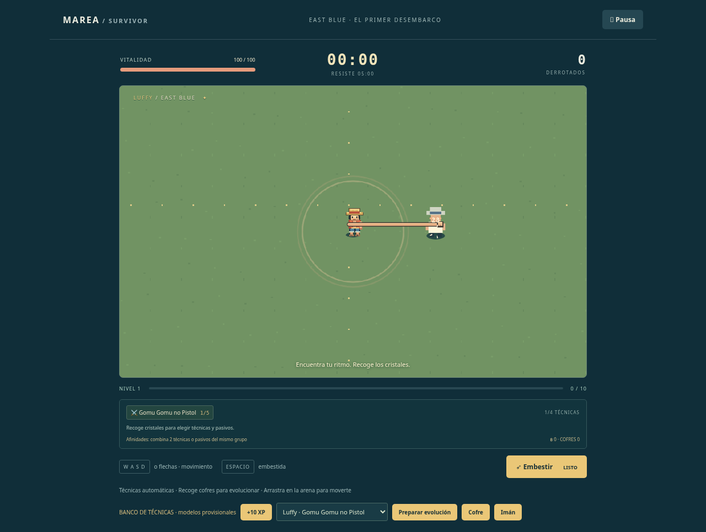
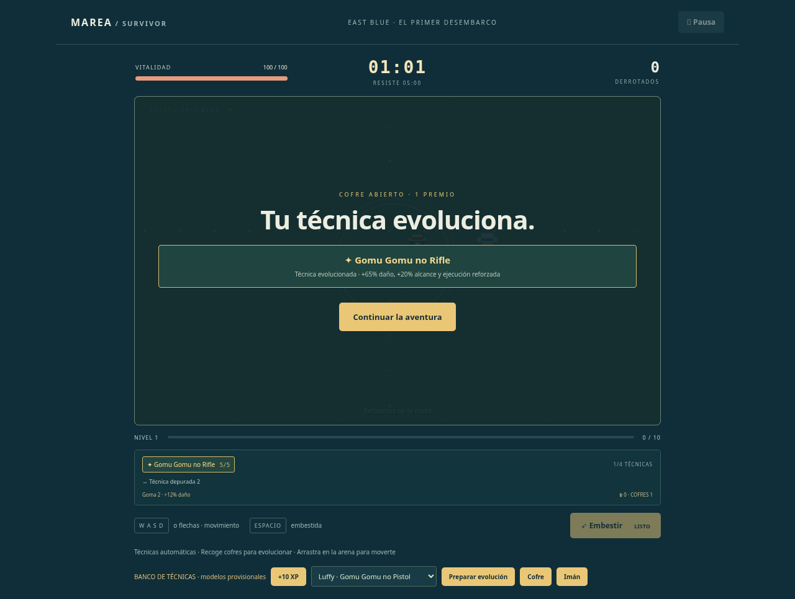

# Catálogo de combate — FASE 2

La fuente de verdad es src/data/content.ts. Los valores siguientes son iniciales de balance. Técnicas exclusivas: el personaje solo aprende las suyas. Los nombres con sufijo son mejoras originales del juego; no desbloquean Gears ni formas de fase 3.

## 18 técnicas y sus evoluciones

| Personaje | Técnica                | Afinidad   | Daño base por impacto | Recarga base | Evolución                        | Pasivo requerido    |
| --------- | ---------------------- | ---------- | --------------------- | ------------ | -------------------------------- | ------------------- |
| Luffy     | Gomu Gomu no Pistol    | Goma       | 28                    | 0.68 s       | Gomu Gomu no Rifle               | Técnica depurada    |
| Luffy     | Gomu Gomu no Gatling   | Goma       | 13                    | 1.25 s       | Gomu Gomu no Storm               | Ritmo de aventura   |
| Luffy     | Gomu Gomu no Bazooka   | Goma       | 48                    | 2.1 s        | Gomu Gomu no Cannon              | Voluntad de combate |
| Luffy     | Gomu Gomu no Muchi     | Goma       | 26                    | 1.7 s        | Muchi · Barrido completo         | Pies ligeros        |
| Luffy     | Gomu Gomu no Fusen     | Goma       | 20                    | 3.1 s        | Fusen · Rebote reforzado         | Ración de viaje     |
| Zoro      | Oni Giri               | Acero      | 42                    | 1.1 s        | Oni Giri · Corte encadenado      | Voluntad de combate |
| Zoro      | 36 Pound Ho            | Acero      | 32                    | 1.4 s        | 108 Pound Ho                     | Técnica depurada    |
| Sanji     | Collier Shoot          | Cuerpo     | 38                    | 0.95 s       | Collier · Combo de patadas       | Ritmo de aventura   |
| Sanji     | Concassé               | Cuerpo     | 52                    | 2.3 s        | Concassé · Impacto ampliado      | Voluntad de combate |
| Nami      | Thunderbolt Tempo      | Clima      | 48                    | 1.7 s        | Thunderbolt Tempo · Tormenta     | Pulso sostenido     |
| Nami      | Cyclone Tempo          | Clima      | 14                    | 2.4 s        | Cyclone Tempo · Vendaval         | Técnica depurada    |
| Usopp     | Estrella de fuego      | Fuego      | 34                    | 1.05 s       | Estrella de fuego · Estallido    | Instinto ofensivo   |
| Usopp     | Pop Green · Enredadera | Naturaleza | 18                    | 2 s          | Pop Green · Jardín de tallos     | Pulso sostenido     |
| Chopper   | Kokutei                | Naturaleza | 44                    | 1.2 s        | Kokutei · Doble impacto          | Ración de viaje     |
| Robin     | Clutch                 | Cuerpo     | 40                    | 1.6 s        | Clutch · Presa múltiple          | Pulso sostenido     |
| Franky    | Strong Right           | Ingenio    | 42                    | 1.25 s       | Strong Right · Retorno de cadena | Guardia firme       |
| Brook     | Aubade Coup Droit      | Alma       | 40                    | 1.15 s       | Aubade · Doble estocada          | Espíritu indomable  |
| Jinbe     | Samegawara Seiken      | Marea      | 46                    | 1.5 s        | Samegawara · Onda profunda       | Guardia firme       |

Cada técnica tiene cinco rangos (+18% de daño base por rango adicional). Una evolución exige técnica rango 5, pasivo requerido rango 2, al menos 60 segundos de partida y recoger un cofre. Consume un premio del cofre, no el pasivo; solo puede evolucionar una vez. +65% de daño y +20% de alcance; las ráfagas suman dos impactos, Rifle añade torsión visual y la Estrella de fuego evolucionada explota al impactar. Los ataques se resuelven con preparación, impactos discretos y recuperación; el barrido de Muchi comprueba la pierna durante su giro y solo golpea una vez a cada enemigo por ejecución.

## 14 pasivos

| Pasivo               | Rangos | Afinidad   | Efecto por rango                                       |
| -------------------- | ------ | ---------- | ------------------------------------------------------ |
| Voluntad de combate  | 5      | Cuerpo     | +25% de daño base.                                     |
| Ritmo de aventura    | 5      | Goma       | 12% menos de recarga.                                  |
| Cadena de golpes     | 4      | Goma       | +1 impacto en ráfagas; +8% de daño en ataques simples. |
| Pies ligeros         | 5      | Cuerpo     | +10% de velocidad base.                                |
| Brújula de botín     | 5      | Ingenio    | +45 de radio de recogida.                              |
| Ración de viaje      | 5      | Cuerpo     | +20 de vida máxima; recupera 35 de vida.               |
| Guardia firme        | 5      | Acero      | Reduce el daño de contacto en 2, mínimo 1.             |
| Botiquín de cubierta | 5      | Naturaleza | Recupera 0,35 de vida por segundo.                     |
| Instinto ofensivo    | 5      | Fuego      | +6% de probabilidad de crítico (daño ×1,7).            |
| Técnica depurada     | 5      | Goma       | +12% de alcance y área.                                |
| Pulso sostenido      | 5      | Clima      | +15% de fase activa y daño de técnicas persistentes.   |
| Viento a favor       | 5      | Clima      | Mejora la probabilidad de cofres de 3 y 5 premios.     |
| Bolsa de navegante   | 5      | Marea      | +20% de berries recogidos durante esta partida.        |
| Espíritu indomable   | 5      | Alma       | 8% menos de recarga de embestida y +5% de daño.        |

Máximo cuatro técnicas y seis pasivos distintos. Se pueden mejorar los adquiridos aunque los huecos estén llenos. No se ofrecen rangos agotados ni técnicas de otro personaje. Cada nivel garantiza una opción de técnica mientras exista una elegible; el resto se elige sin duplicados.

## Afinidades

Cada técnica equipada y cada pasivo adquirido aportan un punto a su grupo, independientemente del rango. Dos puntos: +12% de daño para las técnicas de ese grupo. Tres puntos: además +8% de alcance de esas técnicas. No hay bonos acumulativos por encima de tres puntos. Un pasivo etiquetado Fuego no concede fuego a Luffy ni cambia sus animaciones. El multiplicador se captura al iniciar la técnica.

## Cofres y recogibles

Primer cofre a 00:35; siguientes cada 55 s, con cuatro como máximo en el suelo. Aparecen cerca del jugador y se señalan en la brújula cuando están lejos. Se abren al acercarse y detienen la simulación hasta continuar. Premios: 1/3/5 con probabilidades base 70%/25%/5%. Cada rango de suerte aumenta en un punto porcentual las dos categorías superiores (por eso el umbral acumulado de 3/5 crece en dos). Primero se resuelven evoluciones elegibles, luego mejoras compatibles; cuando no quedan mejoras, se entregan berries. Cada premio se aplica una sola vez.

- Cristales: experiencia, con atracción gradual.
- Carne: 18 de vida, sin superar el máximo; cada 18 bajas.
- Berries: 10, cada nueve bajas; afectados por Bolsa de navegante. Solo se contabilizan en la partida, sin guardado de cuenta todavía.
- Cada 70 bajas cae uno entre imán, barril e impulso, con igual probabilidad.
- Imán: atrae todos los cristales y berries presentes.
- Barril de pólvora: 180 de daño a enemigos en radio 600. Es un objeto ambiental, no una técnica de Luffy.
- Impulso: ocho segundos de velocidad ×1,25 y cadencia ×1,2; acumulable hasta 16 segundos.

Límites: 150 enemigos, 240 recogibles, cuatro cofres, 16 animaciones activas y 180 efectos. Cuando se llena el límite de recogibles, la experiencia se fusiona con un cristal existente para conservarla. La prueba de estrés definitiva sigue en fase 6.

## Presentación y alcance

Puños y piernas elásticos conectados al actor, preparación corporal, torsión de Rifle, hinchado de Fusen, espadas, patadas, Clima-Tact/nubes/rayos, tirachinas y munición, plantas, pezuñas, brazos de Robin, cadena mecánica, estocada y karate gyojin tienen renderizadores procedurales diferenciados. Las siluetas definitivas de los diez personajes y sus tres formas pertenecen a fase 3. En modo normal se juega con Luffy; las demás técnicas se pueden comprobar en ?debug, cambiando también la identidad del actor de prueba para respetar compatibilidades.

Juice de esta fase: anticipación/ejecución/recuperación, estiramiento, empuje, destello de daño, partículas de eliminación, números flotantes, críticos destacados, pausa de impacto breve, sacudida al recibir daño, señal roja de daño, anillos de nivel/evolución/curación/explosión, estela de embestida, pulso de recogida y brillo de cofres. Con reducción de movimiento se atenúan sacudidas, desplazamiento de números y partículas y se omite la pausa de impacto; se conserva la lectura funcional de la técnica. El audio y los ajustes completos siguen en fase 6.

Capturas del banco de prueba, no de una partida sin depuración:

## Integración de FASE 3

Los diez propietarios ya se pueden elegir en el puerto, con tres estilos e innatos definidos en `src/data/crew.ts`. Las evoluciones de esta tabla siguen siendo mejoras de técnica independientes de los estilos. Los nakama ejecutan su técnica inicial desde su posición; no añaden sus armas a las ofertas del capitán. Energía, apoyos y estilos se documentan en GDD. F o botones permiten transformar; `?debug` añade «Desbloquear formas» para probar sin subir ocho niveles.
